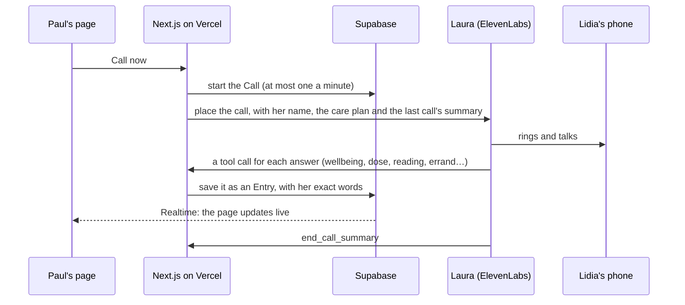

# Laura

A daily phone companion for elderly people who live alone, and a live page for the family member who looks after them.

Press **Call now** and Laura, an AI voice agent, phones Lidia, who is 94. As Lidia answers, the page Paul reads fills in with her own words: how she slept, how her leg is, her blood pressure, which tablets she took while on the line, what she needs from the shop, and anything she wants passed on.

**Live demo:** https://laura-demo.vercel.app

All people, phone conversations and medical data in this repo are fictional sample data.

## The call

One call, eight short beats, about two and a half minutes. Each thing Lidia says becomes one card on the page within a second or two, quoted word for word.

| # | Laura says | What the page shows |
|---|---|---|
| 1 | "Hello, is that Lidia?" Only once she says yes: "Hi Lidia, it's Laura... Your family phrase... Paul says the blue teapot is still his favourite." | The Call goes live |
| 2 | "How are you today?" Then one thing she remembers from the last call: "Yesterday you slept badly... How was last night?" | Wellbeing and Sleep, in her words |
| 3 | "And how is your left leg?" | A new note on the left leg, above the earlier ones |
| 4 | "What was your blood pressure this morning?" "140 over 80... noted." | The Reading, added to the history |
| 5 | "Time for your tablets... First, Concor... Take your time, I'll wait." She stays silent until Lidia says it is taken, then the next. | Each tablet turns to taken, and the two-week tablet count moves |
| 6 | "Is there anything Paul should bring you?" | Each item on a shopping list Paul can tick off |
| 7 | "Any message for Paul?" | The message under "For Paul" |
| 8 | "I'll tell Paul everything... Goodbye, Lidia." | Laura's short summary; the Call is done |

## Trust and safety

Laura reminds and records. She never interprets and never advises.

- **The family phrase** is said only after the person confirms she is Lidia. A neighbour or a voicemail hears nothing personal.
- **No medical advice.** "Should I take half a tablet?" is declined kindly and passed to Paul word for word.
- **Emergencies.** Chest pain or a fall: Laura passes it on, tells Lidia to hang up and call 112, and ends the call herself.
- **Readings are repeated, never judged.** "150 over 95... noted." Nothing about good or bad.
- **Only the care plan.** Tablet names come from the stored care plan; the server refuses any other medicine.
- **Never a person.** Asked if she is real, she says she is a computer assistant Paul set up. She never asks for money, passwords or codes.
- **Platform guardrails** in ElevenLabs back these rules up: Focus, prompt-injection detection, content filters, and three custom checks (never claims to be human, never asks for money or codes, no medical advice). The medical, violence and self-harm content filters are deliberately off, so tablet names, Readings and the 112 line never drop a call. The settings live in [`agent/agent.json`](agent/agent.json).

## How it works



- **Laura is defined in this repo.** Her instructions, seven tools, voice and guardrails are in [`agent/`](agent/), and `npm run laura-agent` creates or updates her in ElevenLabs.
- **One webhook, seven tools.** [`app/api/tools/[tool]/route.ts`](app/api/tools/%5Btool%5D/route.ts) checks a shared secret on every request. The `call_id` is filled in by ElevenLabs from the per-call variables, so the language model never sees or invents it.
- **One table for everything Lidia says** ([ADR 0002](docs/adr/0002-one-entries-table.md)), and "today" is simply the latest Call ([ADR 0001](docs/adr/0001-today-is-the-latest-call.md)).
- **Call now cannot be spammed.** A Postgres function takes a lock and allows one Call a minute, and the route refuses requests from other websites.
- **The page reads, the server writes.** The browser only has a read-only key; every write goes through the server.

## Repo map

```text
agent/        Laura: instructions, tools, voice and guardrails
app/          the page and the three server routes (tools, Call now, ticking an errand)
components/   the page's components, from the laura-design skill
lib/          dashboard state, database clients, environment checks
scripts/      sample-data reset, and the script that pushes Laura to ElevenLabs
supabase/     database migrations
tests/        integration tests against a local database
docs/         the demo brief, ADRs, and agent notes
GLOSSARY.md   the domain terms (Call, Entry, Dose, Pass-on, ...)
```

## Run it

You need Node 24, the Supabase CLI with Docker for the tests, and an ElevenLabs account with a phone number.

```bash
npm install
cp .env.example .env.local      # fill in the values
supabase db push                # create the tables in your Supabase project
npm run sample-data             # Lidia's care plan and two weeks of History
npm run laura-agent             # create Laura in ElevenLabs and attach the phone number
npm run dev
```

Tests run against a local database and fake the outbound call, so they never ring a phone:

```bash
supabase start
npm test
```

## How it was built

The demo started as a written brief ([`docs/demo-brief.md`](docs/demo-brief.md)) and a spec, [issue #1](https://github.com/Whirlywack/laura-demo/issues/1), cut into fourteen tickets (#2 to #15). Each ticket was built test-first by a Claude Code agent in its own worktree, merged into one integration branch, reviewed against the spec, and then tested with live phone calls. The voice, the wording and the guardrails were tuned from those calls.
